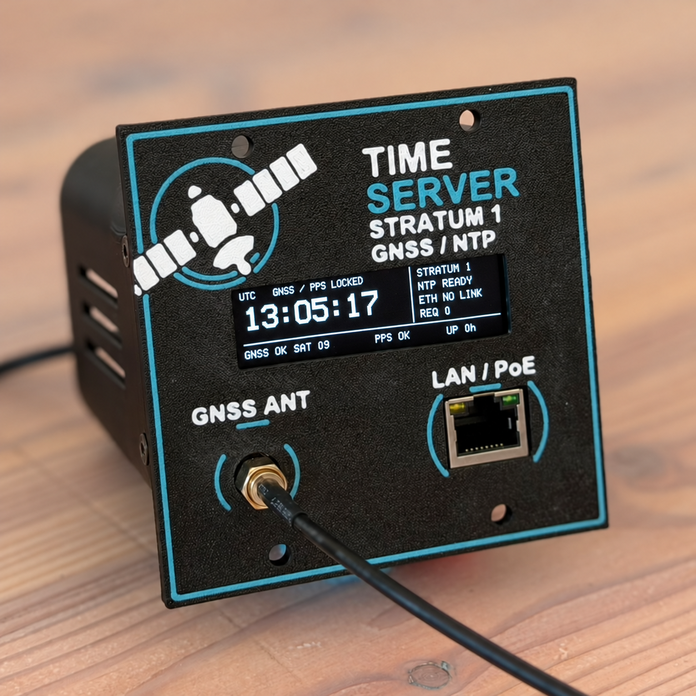

# ESP32TimeServer — P4 OLED Rack Edition



GNSS-synchronized Stratum-1 NTP server with an OLED display and HTTPS web management.
Based on
[roblatour/ESP32TimeServer](https://github.com/roblatour/ESP32TimeServer) v3.0.4.

## Hardware

- LUCKFOX ESP32-P4-POE-ETH-NH / Waveshare ESP32-P4-ETH, IP101 Ethernet/PoE.
- SparkFun MAX-M10S GNSS receiver (GPS-18037) with PPS and SMA antenna.
- GME25664-65 SH1122 OLED, 256×64, SPI.
- Printed insert for **two segments of the DAP MP-1 2U rack frame**.

[Wiring](docs/HARDWARE.md) · [Front panel and rear cover downloads](hardware/dap-mp1-2u/README.md)

## Features

- NTPv3/v4 with GNSS/PPS synchronization and optional client key authentication.
- UTC, stratum, network and receiver status on the OLED, with gentle dimming.
- Responsive HTTPS status page and password-protected settings.
- DHCP or static IP, display settings and firmware updates over Ethernet.

## Getting started

Build with **ESP-IDF v6.1**, Python, Git and OpenSSL:

```sh
git clone --recurse-submodules https://github.com/42bios/ESP32TimeServer.git
cd ESP32TimeServer
. /path/to/esp-idf/export.sh
./BUILD.sh
idf.py -p /dev/your-serial-port flash monitor
```

Open `https://<IP>/`. Settings use the initial password generated in
`local-backups/WEB-ACCESS.txt`; change it under **Access**. Verify and trust the
local device certificate before signing in. Keep generated credentials and TLS
keys private and retain them for future builds.

[Build instructions](docs/BUILD.md) · [Web management and HTTPS](docs/WEB-MANAGEMENT.md) · [NTP keys](docs/NTP-AUTHENTICATION.md)

## License

MIT; original code © Rob Latour. See [LICENSE](LICENSE).
U8g2 and SparkFun GNSS retain their own license notices.
